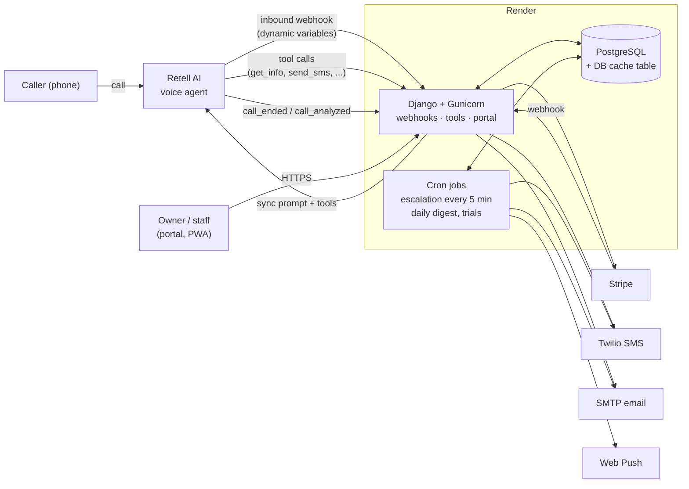

# AI Concierge: Restaurant Phone Agent Backend

A Django backend for an AI phone concierge that answers calls for restaurants. Restaurants forward their line to a [Retell AI](https://www.retellai.com/) voice agent. This app gives that agent its knowledge (hours, menu, booking rules, who's calling), runs the tools it uses mid-call (look up info, text the caller a link), and turns every finished call into something staff can act on: an alert, a reservation request, a follow-up, a billing entry.

Restaurant owners manage all of it from a web portal: the knowledge base the agent speaks from, call history with transcripts, guest profiles, notification settings, and prepaid billing through [Stripe](https://stripe.com/).

## Demo

...

| Owner dashboard | Call history | Knowledge base editor |
|---|---|---|
|  |  |  |

**Hear it:** _call recording link goes here._ The public `/demo/` page also lets a visitor enter a phone number and get a live call from the agent (Turnstile anti-bot check, rate-limited to 1 call per number per hour and 3 per IP per day).

## What it does

- **Answers with live restaurant facts.** When a call connects, Retell calls `/api/retell/webhook/<id>/` and the backend returns that restaurant's dynamic variables (name, address, today's date and time in the restaurant's timezone, large-party and escalation rules, plus a summary of this caller's history) straight into the agent's prompt.
- **Runs tools during the call.** The agent can ask for one knowledge-base topic on demand (`get_info`), load the caller's profile (`get_caller_profile`), resolve "next Friday" into a real date, and text the caller a menu, address, or pre-filled OpenTable link, but only after they say yes.
- **Turns finished calls into work.** `call_analyzed` events become a `CallDetail` (reason, reservation request, complaint, follow-up needed, spam) and a `CallerMemory` profile update. Each signal triggers its own email alert, and questions the agent couldn't answer are reported back to the owner as knowledge-base gaps.
- **Escalates until someone responds.** Urgent calls create an action token. A cron job sends a push reminder at 15 minutes, a push plus an SMS to the caller at 30, and a final email at 60.
- **Bills by usage.** A Stripe subscription plus a prepaid communication balance. Each `call_ended` event deducts Retell's cost times a per-restaurant markup. The owner is warned at $8 and $3, and the phone line is disconnected from the agent at $0.
- **Owner portal.** Multi-user (owner and operators with per-role permissions), installable as a PWA with web push, plus daily digests and an AI-written weekly report.

## Architecture



The two webhooks that matter:

1. **Inbound (`/api/retell/webhook/<id>/`)**: called the moment a call connects. It checks that the account and subscription are active and the balance is positive, verifies Retell's signature, and returns `dynamic_variables` for the prompt. If the account is inactive, it still returns `200` with a directive telling the agent to say the line is unavailable and hang up. Otherwise Retell would fall back to its default agent.
2. **Events (`/api/retell/events/`)**: called when a call ends and again when it's analyzed. It deducts the call cost, stores the call, updates the caller's profile, and sends alerts.

## Why these choices

**Prompt facts injected per call, not baked into the agent.** Each restaurant's knowledge base lives in Postgres, and the inbound webhook rebuilds the dynamic variables on every call. An owner who changes tonight's hours in the portal is heard on the very next call, with no redeploy and no manual edit in Retell. Detailed sections (hours, menus, parking, private events, and so on) stay out of the prompt and are fetched with the `get_info` tool only when a caller asks, which keeps the prompt short and the agent focused.

**The caller is identified from Retell's call context, never from what the model says.** `get_caller_profile` and `send_sms` read `from_number` and `to_number` from the signed call payload. A guest who tells the agent "I'm calling for +1 305..." can't pull someone else's profile, and a profile can't leak across restaurants because every lookup is scoped by the number that was dialed. The same rule means `send_sms` can only text the person who is actually on the call.


**Every webhook verifies a signature against that restaurant's key.** Retell signs each request. The backend looks up the restaurant by the number dialed and verifies the signature with that restaurant's own API key, so one tenant's key can't sign requests for another. Stripe webhooks are verified with `stripe.Webhook.construct_event`.


**SMS only with consent.** The agent texts a caller only through the `send_sms` tool, whose definition tells it to call the tool after the caller explicitly agrees. An earlier automatic post-call text was turned off for this reason. Message bodies come from per-restaurant templates with tokens, so owners control the wording.

**Prepaid balance instead of pure post-paid metering.** Voice minutes cost real money the moment a call happens. A prepaid balance with a markup means a restaurant that stops paying can't run up a bill: at $0 the number is disconnected from the agent, and the inbound webhook rejects calls even if that disconnect failed.

**Render cron jobs instead of a Celery worker.** Escalation, digests, trial expiry, and reminders run as short `manage.py` commands on a schedule. That keeps the deploy to one web service, one database, and a few crons, with no broker to run. The escalation job is state-based: each token stores the level it has reached, and the level only advances after the send succeeds, so a late or missed cron run retries instead of skipping or double-sending. The trade-off is that alert emails sent from the web process use fire-and-forget threads, which have no retry if the process restarts mid-send. A task queue is the next step if volume grows.

**Postgres-backed cache.** Push throttling, quiet hours, and demo-call rate limits use Django's database cache, so there's no Redis to provision for what is a few keys per minute.


# Stack
| Layer | Choice |
|---|---|
| Backend | Django 6, Gunicorn |
| Voice agent | Retell AI (inbound webhook, custom tools, event webhooks) |
| Database | PostgreSQL (prod), SQLite (local) |
| Payments | Stripe Checkout, Billing Portal, webhooks |
| Messaging | Twilio SMS, SMTP email, Web Push (VAPID) |
| AI reports | Anthropic API (weekly report summaries) |
| Static files | WhiteNoise |
| Hosting | Render (web service, cron jobs, managed Postgres) via `render.yaml` |

### 1. Install

```bash
python3 -m venv .venv
source .venv/bin/activate
pip install -r backend/requirements.txt
```

### 2. Environment variables

Copy [`.env.example`](.env.example) to `backend/.env` and fill it in. It lists every variable with a comment, including Stripe, Twilio, VAPID keys (`python scripts/generate_vapid.py`), and the Anthropic key. Per-restaurant Retell and Twilio credentials are stored in the database, not in `.env`.

### 3. Database
```bash
cd backend
python manage.py migrate
python manage.py createcachetable
python manage.py createsuperuser
```

### 4. Run

Retell and Stripe need to reach your webhooks, so expose localhost with a tunnel (ngrok or Cloudflare Tunnel) and set `RETELL_WEBHOOK_URL` to the tunnel URL. In `DEBUG` mode, `*.ngrok-free.app` and `*.trycloudflare.com` are already allowed hosts.

## What I'd change next

- **Split `restaurants/views.py`.** It grew to about 7,000 lines as features landed. The plan is to split it by area (Retell webhooks and tools, portal, billing, notifications) into a `views/` package and move the email and SMS helpers into `services/`, where `retell_tools.py` and `retell_client.py` already live.
- **Move alert delivery to a task queue**, so a send that fails is retried instead of lost with its thread.
- **Run the tests in CI** on every push.
